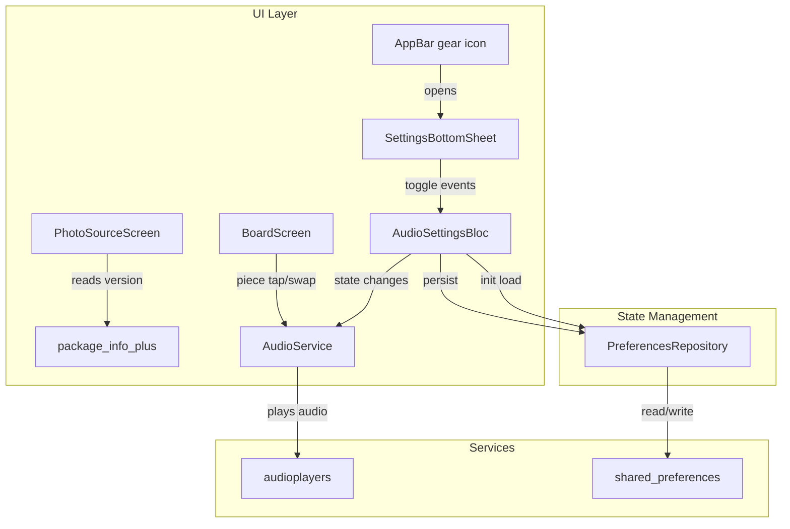

# Design Document: Audio, Settings & Version Display

## Overview

This feature adds three capabilities to the Jigsaw Puzzle Game:

1. **Audio system** — background music (looping) and sound effects (tap/swap) powered by the `audioplayers` package.
2. **Settings dialog** — a modal bottom sheet accessible via a gear icon on every screen's AppBar, with toggles for background music and sound effects.
3. **Version display** — the app version string shown on the PhotoSourceScreen, read at runtime via `package_info_plus`.

Audio preferences persist across sessions using `shared_preferences`. Placeholder WAV audio files are generated programmatically with a Dart script (short sine-wave tones) since real audio assets cannot be downloaded.

## Architecture

The feature follows the existing BLoC architecture. A new `AudioSettingsBloc` (Cubit) manages the enabled/disabled state for background music and sound effects. An `AudioService` wraps `audioplayers` for playback. A `PreferencesRepository` handles persistence via `shared_preferences`.



### Key Design Decisions

| Decision | Rationale |
|---|---|
| Use Cubit instead of full Bloc | Audio settings state is simple (two booleans). Cubit avoids event class boilerplate. |
| AudioService as a standalone class (not a Bloc) | Playback is imperative (play/stop/pause). A service with methods is more natural than event-driven state. |
| PreferencesRepository as an abstraction | Enables unit testing with a mock, decouples from SharedPreferences directly. |
| Gear icon via a shared helper/mixin | Avoids duplicating the settings icon + bottom sheet logic across four screens. |
| Programmatic WAV generation | We cannot download real audio files, so a Dart script generates minimal valid WAV files (sine-wave tones). |
| App lifecycle handling in main.dart | The `WidgetsBindingObserver` is added at the app level to pause/resume background music on lifecycle changes. |

## Components and Interfaces

### AudioService

Wraps `audioplayers` for all audio playback. Manages two `AudioPlayer` instances: one for background music (looping) and one for sound effects (one-shot).

```dart
abstract class AudioService {
  /// Start looping background music from the beginning.
  Future<void> playBackgroundMusic();

  /// Stop background music.
  Future<void> stopBackgroundMusic();

  /// Pause background music (for app lifecycle).
  Future<void> pauseBackgroundMusic();

  /// Resume background music (for app lifecycle).
  Future<void> resumeBackgroundMusic();

  /// Play the tap sound effect (one-shot).
  Future<void> playTapSound();

  /// Play the swap sound effect (one-shot).
  Future<void> playSwapSound();

  /// Release all audio resources.
  Future<void> dispose();
}
```

Implementation: `AudioServiceImpl` creates two `AudioPlayer` instances. The background music player is set to `ReleaseMode.loop`. Sound effect methods use `AudioPlayer.play(AssetSource(...))`.

### PreferencesRepository

Abstracts `shared_preferences` for audio settings persistence.

```dart
abstract class PreferencesRepository {
  /// Load saved audio settings. Returns defaults if none saved.
  Future<AudioSettings> loadAudioSettings();

  /// Persist audio settings.
  Future<void> saveAudioSettings(AudioSettings settings);
}
```

Implementation: `PreferencesRepositoryImpl` uses `SharedPreferences` with keys `audio_sfx_enabled` and `audio_music_enabled`. Defaults to both `true` when keys are absent.

### AudioSettingsBloc (Cubit)

Manages the audio toggle state. On creation, loads persisted settings. Exposes methods to toggle each setting, persists changes, and notifies the `AudioService`.

```dart
class AudioSettingsCubit extends Cubit<AudioSettingsState> {
  final PreferencesRepository _preferencesRepository;
  final AudioService _audioService;

  AudioSettingsCubit({
    required PreferencesRepository preferencesRepository,
    required AudioService audioService,
  }) : super(const AudioSettingsState());

  Future<void> init() async { /* load from prefs, start music if enabled */ }
  Future<void> toggleSoundEffects() async { /* toggle, persist, emit */ }
  Future<void> toggleBackgroundMusic() async { /* toggle, persist, start/stop music */ }
  Future<void> onLifecyclePaused() async { /* pause music */ }
  Future<void> onLifecycleResumed() async { /* resume music if enabled */ }
}
```

### SettingsBottomSheet

A widget shown as a modal bottom sheet. Contains two `SwitchListTile` widgets bound to `AudioSettingsCubit` state.

```dart
class SettingsBottomSheet extends StatelessWidget {
  // Reads AudioSettingsCubit via BlocBuilder.
  // Calls cubit.toggleSoundEffects() / cubit.toggleBackgroundMusic() on change.
}
```

### Settings Icon Helper

A reusable function or widget that returns the gear `IconButton` + opens the `SettingsBottomSheet`. Added to each screen's `AppBar.actions`.

```dart
Widget buildSettingsAction(BuildContext context) {
  return IconButton(
    icon: const Icon(Icons.settings),
    tooltip: 'Settings',
    onPressed: () => showModalBottomSheet(
      context: context,
      builder: (_) => BlocProvider.value(
        value: context.read<AudioSettingsCubit>(),
        child: const SettingsBottomSheet(),
      ),
    ),
  );
}
```

### Version Display

On `PhotoSourceScreen`, a `FutureBuilder` reads `PackageInfo.fromPlatform()` and displays `"v${info.version}"` below the action buttons in a subdued text style.

### Audio Asset Generator

A standalone Dart script (`tool/generate_audio.dart`) that programmatically creates three minimal WAV files:
- `assets/audio/background_music.wav` — a longer tone (~5 seconds, lower frequency)
- `assets/audio/tap_sound.wav` — a short blip (~0.15 seconds, higher frequency)
- `assets/audio/swap_sound.wav` — a short blip (~0.2 seconds, different frequency)

Each file is a valid PCM WAV (16-bit, mono, 44100 Hz) with a sine-wave tone.

## Data Models

### AudioSettings

```dart
class AudioSettings extends Equatable {
  final bool soundEffectsEnabled;
  final bool backgroundMusicEnabled;

  const AudioSettings({
    this.soundEffectsEnabled = true,
    this.backgroundMusicEnabled = true,
  });

  AudioSettings copyWith({
    bool? soundEffectsEnabled,
    bool? backgroundMusicEnabled,
  }) {
    return AudioSettings(
      soundEffectsEnabled: soundEffectsEnabled ?? this.soundEffectsEnabled,
      backgroundMusicEnabled: backgroundMusicEnabled ?? this.backgroundMusicEnabled,
    );
  }

  @override
  List<Object?> get props => [soundEffectsEnabled, backgroundMusicEnabled];
}
```

### AudioSettingsState

The Cubit state wraps `AudioSettings` plus a loading flag:

```dart
class AudioSettingsState extends Equatable {
  final bool isLoaded;
  final AudioSettings settings;

  const AudioSettingsState({
    this.isLoaded = false,
    this.settings = const AudioSettings(),
  });

  @override
  List<Object?> get props => [isLoaded, settings];
}
```

### SharedPreferences Keys

| Key | Type | Default |
|---|---|---|
| `audio_sfx_enabled` | `bool` | `true` |
| `audio_music_enabled` | `bool` | `true` |

### WAV File Format (generated assets)

| Field | Value |
|---|---|
| Sample rate | 44100 Hz |
| Bit depth | 16-bit |
| Channels | 1 (mono) |
| Encoding | PCM |


## Correctness Properties

*A property is a characteristic or behavior that should hold true across all valid executions of a system — essentially, a formal statement about what the system should do. Properties serve as the bridge between human-readable specifications and machine-verifiable correctness guarantees.*

### Property 1: Settings dialog reflects current audio state

*For any* combination of `soundEffectsEnabled` and `backgroundMusicEnabled` values in the `AudioSettingsCubit` state, opening the `SettingsBottomSheet` should display toggle switches whose on/off positions match those values exactly.

**Validates: Requirements 1.4**

### Property 2: Toggle action updates bloc state correctly

*For any* initial `AudioSettings` state and any toggle action (toggle sound effects or toggle background music), the resulting `AudioSettingsCubit` state should have the targeted boolean flipped and the other boolean unchanged.

**Validates: Requirements 1.5**

### Property 3: Sound effect playback matches enabled state and interaction type

*For any* user interaction on the BoardScreen (piece tap or piece swap) and *for any* `soundEffectsEnabled` value, a sound is played if and only if `soundEffectsEnabled` is `true`. When played, the sound type must match the interaction: tap interactions produce the tap sound, swap interactions produce the swap sound.

**Validates: Requirements 3.1, 3.2, 3.3**

### Property 4: Audio preferences round-trip through persistence

*For any* valid `AudioSettings` object, saving it via `PreferencesRepository.saveAudioSettings` and then loading it via `PreferencesRepository.loadAudioSettings` should return an `AudioSettings` object equal to the original.

**Validates: Requirements 4.1, 4.2**

## Error Handling

| Scenario | Handling |
|---|---|
| `audioplayers` fails to play a file | Catch the exception in `AudioServiceImpl`, log it, and continue silently. Audio failure should never crash the app or block puzzle gameplay. |
| `shared_preferences` fails to read/write | Catch the exception in `PreferencesRepositoryImpl`, return default settings on read failure, and silently ignore write failure. |
| `package_info_plus` fails to retrieve version | Display an empty string or "v?.?.?" as a fallback in the version label. |
| Audio asset files missing at runtime | `audioplayers` will throw; caught by `AudioServiceImpl` as above. The generator script ensures assets exist at build time. |
| App lifecycle transitions while audio is already stopped | `pauseBackgroundMusic` and `resumeBackgroundMusic` are no-ops when the player is already in the target state. |

## Testing Strategy

### Unit Tests

- **AudioSettingsCubit**: Use `bloc_test` to verify `toggleSoundEffects` and `toggleBackgroundMusic` emit correct states. Mock `PreferencesRepository` and `AudioService`.
- **PreferencesRepositoryImpl**: Test with a mock `SharedPreferences` instance. Verify save/load round-trip and default values when keys are absent.
- **AudioServiceImpl**: Mock `AudioPlayer` instances. Verify `playBackgroundMusic` sets loop mode and calls play. Verify `playTapSound`/`playSwapSound` call play with correct asset sources.
- **Version display**: Verify `PackageInfo.fromPlatform()` is called and the result is rendered.

### Widget Tests

- **SettingsBottomSheet**: Pump the widget with a seeded `AudioSettingsCubit`. Verify two `SwitchListTile` widgets with correct labels. Tap toggles and verify cubit methods are called.
- **Gear icon on each screen**: For each of the four screens, pump with required blocs and verify an `Icons.settings` `IconButton` exists in the AppBar. Tap it and verify a bottom sheet appears.
- **Version label on PhotoSourceScreen**: Pump the screen and verify a text widget containing the version string is present below the action buttons.

### Property-Based Tests

Property-based tests use the `glados` package (already in dev_dependencies). Each property test runs a minimum of 100 iterations.

- **Property 1** (Settings dialog reflects state): Generate random `AudioSettings`, seed the cubit, pump `SettingsBottomSheet`, verify toggle positions match.
  - Tag: `Feature: audio-settings-version, Property 1: Settings dialog reflects current audio state`
- **Property 2** (Toggle updates state): Generate random initial `AudioSettings` and a random toggle action, apply it, verify the correct boolean flipped.
  - Tag: `Feature: audio-settings-version, Property 2: Toggle action updates bloc state correctly`
- **Property 3** (Sound playback matches state): Generate random interaction type (tap/swap) and random `soundEffectsEnabled` value, trigger the interaction, verify sound played iff enabled and correct sound type.
  - Tag: `Feature: audio-settings-version, Property 3: Sound effect playback matches enabled state and interaction type`
- **Property 4** (Preferences round-trip): Generate random `AudioSettings`, save then load, verify equality.
  - Tag: `Feature: audio-settings-version, Property 4: Audio preferences round-trip through persistence`

### Integration Tests

- App startup with music enabled: verify `AudioService.playBackgroundMusic` is called.
- App lifecycle pause/resume: verify music pauses and resumes correctly.
- End-to-end settings flow: open settings, toggle, close, reopen, verify state persisted.
