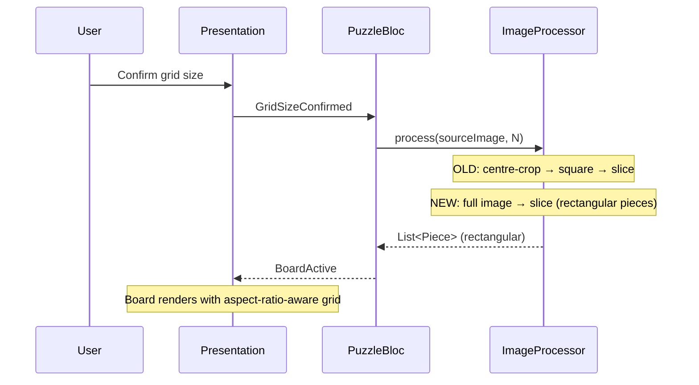

# Design Document: Full Image Puzzle

## Overview

This feature modifies the existing jigsaw puzzle game so that the full source image is used for the puzzle instead of centre-cropping to a square. Currently, `ImageProcessorImpl` crops non-square images to the largest centred square before slicing, discarding portions of landscape or portrait photos. After this change, the entire image is preserved, producing rectangular pieces whose aspect ratio matches the source image's aspect ratio divided by the grid dimensions.

### Key Design Decisions

- **Minimal surface area**: Only the components that assume square images are modified. The BLoC layer, ShuffleEngine, WinDetector, and data model identifiers (`PieceId`, `BoardPosition`, `PuzzleState.swap`, `PuzzleState.isSolved`) are unchanged because they operate on abstract grid positions, not pixel geometry.
- **Integer-division rounding**: Piece dimensions use integer division (`width ~/ N`, `height ~/ N`). A thin strip of edge pixels (at most N−1 pixels per axis) may be excluded. This is acceptable and matches the existing behaviour for the square case.
- **Aspect-ratio-aware layout**: The `BoardScreen` grid and `GridConfigScreen` overlay switch from a square `SizedBox` to one that respects the source image's width-to-height ratio, using `FittedBox` / `AspectRatio` semantics within `LayoutBuilder` constraints.
- **No new dependencies**: All changes use the existing `image`, `flutter_bloc`, and Flutter layout primitives already in `pubspec.yaml`.

### Scope of Changes

| Component | Change |
|---|---|
| `ImageProcessorImpl` | Remove `_centreCrop`; slice full image directly |
| `ImageProcessor` interface | Update doc comment (no functional signature change) |
| `_PuzzleGrid` (BoardScreen) | Compute cell width/height independently; size board to source aspect ratio |
| `_GridOverlayPainter` (GridConfigScreen) | Already draws proportional lines — no code change needed, but the preview image must be rendered with `BoxFit.contain` preserving aspect ratio (already the case) |
| `PuzzlePieceWidget` | No change — already uses `BoxFit.cover` on `Image.memory` |
| Swap animation (`AnimatedPositioned`) | Use separate `cellWidth` / `cellHeight` instead of uniform `cellSize` |
| Property tests | Update round-trip property to compare against full image instead of centre-cropped image |
| Unit tests | Update assertions that assumed square pieces |
| `ImageProcessingException` | Add minimum-dimension validation (`width < N` or `height < N`) |

---

## Architecture

The layered architecture remains identical to the original design:

```
┌─────────────────────────────────────────────────┐
│                  Presentation Layer              │
│  (Flutter Widgets, Screens, Animations)          │
├─────────────────────────────────────────────────┤
│                  BLoC Layer                      │
│  (PuzzleBloc, TimerBloc — unchanged)             │
├─────────────────────────────────────────────────┤
│                  Domain Layer                    │
│  (ImageProcessor ← MODIFIED, ShuffleEngine,      │
│   WinDetector — unchanged)                       │
├─────────────────────────────────────────────────┤
│                  Data / Platform Layer           │
│  (ImagePickerService, PermissionService          │
│   — unchanged)                                   │
└─────────────────────────────────────────────────┘
```

### Data Flow (unchanged)

The event/state flow through `PuzzleBloc` is identical. The only difference is that `ImageProcessor.process()` now returns rectangular pieces derived from the full image rather than square pieces from a centre-cropped image.



---

## Components and Interfaces

### ImageProcessor (MODIFIED)

The abstract interface signature is unchanged. The doc comment is updated to reflect full-image behaviour.

```dart
abstract class ImageProcessor {
  /// Splits [imageBytes] into [n]×[n] pieces using the full image dimensions.
  /// Each piece has width = imageWidth ~/ n, height = imageHeight ~/ n.
  /// Returns exactly n*n Pieces with assigned (row, col) identifiers.
  /// Throws [ImageProcessingException] on failure or if image is too small.
  List<Piece> process(Uint8List imageBytes, int n);
}
```

### ImageProcessorImpl (MODIFIED)

```dart
class ImageProcessorImpl implements ImageProcessor {
  @override
  List<Piece> process(Uint8List imageBytes, int n) {
    final decoded = _decode(imageBytes);
    _validateMinDimensions(decoded, n);
    return _slice(decoded, n);
  }

  img.Image _decode(Uint8List bytes) {
    // decode and throw ImageProcessingException on failure
  }

  void _validateMinDimensions(img.Image image, int n) {
    if (image.width < n || image.height < n) {
      throw ImageProcessingException(
        'Image too small (${image.width}×${image.height}) for grid size $n.',
      );
    }
  }

  List<Piece> _slice(img.Image source, int n) {
    final pieceWidth = source.width ~/ n;
    final pieceHeight = source.height ~/ n;
    // slice into n×n pieces using copyCrop, same as before but without centre-crop
  }
}
```

Key changes:
1. **Removed** `_centreCrop()` method entirely.
2. **Added** `_validateMinDimensions()` to throw when image is smaller than N in either axis.
3. `_slice()` operates on the full decoded image instead of the cropped square.

### Board Layout (_PuzzleGrid) (MODIFIED)

The current implementation computes a single `cellSize` from `min(gridWidth, gridHeight) / n` and uses a square `SizedBox`. The new implementation computes independent `cellWidth` and `cellHeight` based on the source image aspect ratio.

```dart
// Current (square):
final cellSize = min(gridWidth, gridHeight) / n;
SizedBox(width: cellSize * n, height: cellSize * n, ...)

// New (rectangular):
final sourceAspectRatio = sourceImageWidth / sourceImageHeight;
// Fit within available constraints preserving aspect ratio
double boardWidth, boardHeight;
if (constraints.maxWidth / constraints.maxHeight > sourceAspectRatio) {
  boardHeight = constraints.maxHeight;
  boardWidth = boardHeight * sourceAspectRatio;
} else {
  boardWidth = constraints.maxWidth;
  boardHeight = boardWidth / sourceAspectRatio;
}
final cellWidth = boardWidth / n;
final cellHeight = boardHeight / n;
```

The `AnimatedPositioned` children use `cellWidth` and `cellHeight` independently:

```dart
AnimatedPositioned(
  left: pos.col * cellWidth,
  top: pos.row * cellHeight,
  width: cellWidth,
  height: cellHeight,
  ...
)
```

### Source Aspect Ratio Propagation

The `BoardActive` state (and `PuzzleSolved` state) needs to carry the source image's aspect ratio so the board can lay out correctly without re-decoding the image. Two options:

**Option A — Store aspect ratio in `PuzzleState`:**
Add `double sourceAspectRatio` to `PuzzleState`. Set it during `ImageProcessor.process()` or in `PuzzleBloc` after processing.

**Option B — Derive from piece dimensions:**
Decode one piece's image bytes to get `pieceWidth` and `pieceHeight`, then compute `aspectRatio = (pieceWidth * n) / (pieceHeight * n) = pieceWidth / pieceHeight`.

**Decision: Option A** — storing the aspect ratio in `PuzzleState` is simpler and avoids redundant image decoding at render time. `PuzzleState` gains one field:

```dart
class PuzzleState extends Equatable {
  final int gridSize;
  final double sourceAspectRatio; // NEW
  final List<Piece> pieces;
  final Map<PieceId, BoardPosition> placement;
  final int moveCount;
  // ...
}
```

### All Other Components — UNCHANGED

- **ShuffleEngine**: Operates on `List<Piece>` by position, agnostic to pixel dimensions.
- **WinDetector**: Compares `PieceId` ↔ `BoardPosition`, agnostic to pixel dimensions.
- **PuzzleBloc**: Calls `ImageProcessor.process()` and passes results through. The only change is populating `sourceAspectRatio` on `PuzzleState`.
- **PermissionService / ImagePickerService**: Completely unaffected.
- **TimerBloc**: Completely unaffected.
- **PuzzlePieceWidget**: Already uses `BoxFit.cover` on `Image.memory`, which handles rectangular images correctly.
- **GridConfigScreen `_GridOverlayPainter`**: Already draws lines at `size.width / gridSize` and `size.height / gridSize` intervals. Since the preview image uses `BoxFit.contain`, the overlay naturally adapts to the image's aspect ratio. No code change needed.

---

## Data Models

### PuzzleState (MODIFIED)

```dart
class PuzzleState extends Equatable {
  final int gridSize;
  final double sourceAspectRatio; // NEW — width / height of the source image
  final List<Piece> pieces;
  final Map<PieceId, BoardPosition> placement;
  final int moveCount;

  const PuzzleState({
    required this.gridSize,
    required this.sourceAspectRatio, // NEW
    required this.pieces,
    required this.placement,
    this.moveCount = 0,
  });

  bool get isSolved => pieces.every(
    (p) => placement[p.id] == BoardPosition(p.id.row, p.id.col),
  );

  PuzzleState swap(PieceId a, PieceId b) {
    final newPlacement = Map<PieceId, BoardPosition>.from(placement);
    final posA = newPlacement[a]!;
    final posB = newPlacement[b]!;
    newPlacement[a] = posB;
    newPlacement[b] = posA;
    return PuzzleState(
      gridSize: gridSize,
      sourceAspectRatio: sourceAspectRatio, // preserve
      pieces: pieces,
      placement: newPlacement,
      moveCount: moveCount + 1,
    );
  }

  @override
  List<Object?> get props => [gridSize, sourceAspectRatio, pieces, placement, moveCount];
}
```

### All Other Models — UNCHANGED

`PieceId`, `Piece`, `BoardPosition`, `PhotoSource`, `PermissionStatus` remain identical.


---

## Correctness Properties

*A property is a characteristic or behavior that should hold true across all valid executions of a system — essentially, a formal statement about what the system should do. Properties serve as the bridge between human-readable specifications and machine-verifiable correctness guarantees.*

The properties below focus on the changes introduced by this feature. The existing properties from the original jigsaw-puzzle-game design (shuffle ≠ solved, swap round-trip, swap move-count increment, win-detection consistency) remain valid and unchanged — they operate on abstract grid positions and are unaffected by piece geometry.

### Property 1: Piece count and uniform rectangular dimensions

*For any* valid source image and any grid size N in {2, 3, 4, 5, 6}, the ImageProcessor SHALL produce exactly N×N pieces, each with pixel dimensions equal to (sourceWidth ~/ N) × (sourceHeight ~/ N). When the source image is square, pieces SHALL be square.

**Validates: Requirements 2.1, 2.2, 1.3, 2.4**

### Property 2: Piece identifiers cover the full grid

*For any* valid source image and grid size N, the set of PieceIds returned by ImageProcessor SHALL be exactly the set {(r, c) | 0 ≤ r < N, 0 ≤ c < N} with no duplicates.

**Validates: Requirements 2.3**

### Property 3: Full-image round-trip

*For any* valid source image and grid size N in {2, 3, 4, 5, 6}, reassembling all N×N pieces produced by the ImageProcessor in their correct grid positions SHALL reconstruct an image pixel-equivalent to the source image (up to integer-division rounding of edge pixels). No centre-crop or spatial reduction is applied.

**Validates: Requirements 1.1, 1.2, 6.1, 6.2**

### Property 4: Minimum dimension rejection

*For any* image whose width or height is less than N, the ImageProcessor SHALL throw an `ImageProcessingException`.

**Validates: Requirements 7.2**

---

## Error Handling

| Scenario | Component | Handling |
|---|---|---|
| Image decode failure | ImageProcessorImpl | Throw `ImageProcessingException` → PuzzleBloc emits `ImageProcessingError` → show error message, return to source selection |
| Image too small for grid size | ImageProcessorImpl | `_validateMinDimensions` throws `ImageProcessingException('Image too small ...')` when `width < N` or `height < N` |
| Camera/gallery permission denied | PermissionService / PuzzleBloc | Unchanged — emit `PermissionDenied` with appropriate `isPermanent` flag |
| User cancels photo picker | ImagePickerService | Unchanged — return `null`, Bloc stays on current screen |
| Shuffle produces solved state | ShuffleEngine | Unchanged — re-shuffle (bounded retry) |

---

## Testing Strategy

### Unit Tests

Focus on the modified and new behaviour:

- **ImageProcessor**:
  - Correct piece count for each grid size 2–6 with non-square images (landscape and portrait).
  - Correct piece dimensions: `(sourceWidth ~/ N) × (sourceHeight ~/ N)`.
  - Square images produce square pieces with same dimensions as before.
  - `ImageProcessingException` thrown on corrupt/empty input.
  - `ImageProcessingException` thrown when image dimensions < N.
  - No centre-crop: verify pieces cover the full image, not a square sub-region.

- **PuzzleState** (minor update):
  - `sourceAspectRatio` is preserved through `swap()`.
  - Existing `isSolved` and `swap` round-trip tests still pass.

- **PuzzleBloc** (minor update):
  - `sourceAspectRatio` is correctly populated in `BoardActive` state after image processing.
  - `PlayAgainRequested` preserves `sourceAspectRatio`.

### Property-Based Tests

Using the **`glados`** Dart package (already in `dev_dependencies`), run a minimum of **100 iterations** per property.

Each test is tagged with the corresponding design property:

| Test | Tag | Property |
|---|---|---|
| ImageProcessor piece count and dimensions | `Feature: full-image-puzzle, Property 1` | N×N pieces with correct rectangular dimensions |
| ImageProcessor PieceId coverage | `Feature: full-image-puzzle, Property 2` | Full grid coverage, no duplicates |
| ImageProcessor full-image round-trip | `Feature: full-image-puzzle, Property 3` | Reassembly == source image (no crop) |
| ImageProcessor minimum dimension rejection | `Feature: full-image-puzzle, Property 4` | Throws on images too small for grid |

The existing property tests from the original design (shuffle ≠ solved, swap round-trip, swap move-count, win-detection) remain in place and continue to pass without modification.

### Widget Tests

- **BoardScreen**: Verify the grid container's aspect ratio matches the source image's aspect ratio for landscape, portrait, and square images.
- **BoardScreen**: Verify `AnimatedPositioned` children use independent `cellWidth` / `cellHeight` (not uniform `cellSize`).
- **GridConfigScreen**: Verify grid overlay renders correctly on non-square image previews (existing `_GridOverlayPainter` already handles this).
- **Swap animation**: Verify pieces animate to correct rectangular positions without overlap.

### Integration Tests

- **End-to-end with non-square image**: Load a landscape fixture image, process, shuffle, solve, verify completion screen shows the full (uncropped) reconstructed image.
- **End-to-end with square image**: Verify backward compatibility — square images produce the same result as before.
