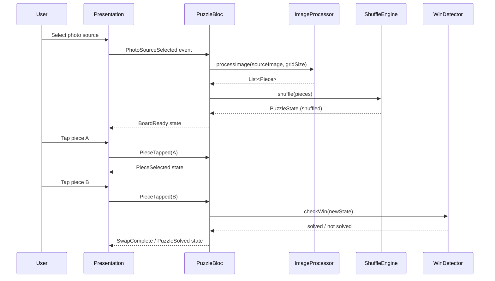

# Design Document: Jigsaw Puzzle Game

## Overview

The Jigsaw Puzzle Game is a mobile application built with Flutter, targeting iOS and Android. Users pick a photo (camera or gallery), choose a grid size (2×2 through 6×6), and then solve the puzzle by swapping tiles until the image is reconstructed. The app tracks elapsed time and move count throughout each session.

### Key Design Decisions

- **Flutter** is chosen for cross-platform support (iOS + Android) with a single codebase, strong widget ecosystem, and smooth animation primitives.
- **BLoC (Business Logic Component)** pattern is used for state management, keeping UI and logic cleanly separated and making the core game logic independently testable.
- **image** package handles image cropping and slicing in pure Dart, avoiding native plugin complexity.
- **image_picker** plugin provides the unified camera/gallery interface on both platforms.
- **Swap-only mechanic** (no empty-space sliding) means any permutation is reachable, simplifying shuffle validation.

---

## Architecture

The app follows a layered architecture:

```
┌─────────────────────────────────────────────────┐
│                  Presentation Layer              │
│  (Flutter Widgets, Screens, Animations)          │
├─────────────────────────────────────────────────┤
│                  BLoC Layer                      │
│  (PuzzleBloc, TimerBloc, PermissionBloc)         │
├─────────────────────────────────────────────────┤
│                  Domain Layer                    │
│  (ImageProcessor, ShuffleEngine, WinDetector)    │
├─────────────────────────────────────────────────┤
│                  Data / Platform Layer           │
│  (ImagePickerService, PermissionService)         │
└─────────────────────────────────────────────────┘
```

### Data Flow



---

## Components and Interfaces

### PermissionService

Wraps `permission_handler` plugin. Abstracts OS-level permission requests.

```dart
abstract class PermissionService {
  Future<PermissionStatus> requestCameraPermission();
  Future<PermissionStatus> requestGalleryPermission();
  Future<void> openAppSettings();
}
```

### ImagePickerService

Wraps `image_picker` plugin. Returns raw image bytes or null on cancellation.

```dart
abstract class ImagePickerService {
  Future<Uint8List?> pickFromCamera();
  Future<Uint8List?> pickFromGallery();
}
```

### ImageProcessor

Pure Dart component. Crops the source image to a centred square, then slices it into N×N equal pieces.

```dart
abstract class ImageProcessor {
  /// Crops [imageBytes] to the largest centred square, then splits into [n]×[n] pieces.
  /// Returns exactly n*n Pieces with assigned (row, col) identifiers.
  /// Throws [ImageProcessingException] on failure.
  List<Piece> process(Uint8List imageBytes, int n);
}
```

### ShuffleEngine

Pure Dart component. Randomises piece positions, guaranteeing the result is not the solved state.

```dart
abstract class ShuffleEngine {
  /// Returns a shuffled copy of [pieces].
  /// Guarantees result != solved order.
  List<Piece> shuffle(List<Piece> pieces);
}
```

### WinDetector

Pure Dart component. Compares current board positions to correct positions.

```dart
abstract class WinDetector {
  /// Returns true iff every piece's boardPosition == its correctPosition.
  bool isSolved(PuzzleState state);
}
```

### PuzzleBloc

Central BLoC managing the full puzzle session lifecycle.

**Events:**
- `PhotoSourceSelected(source: PhotoSource)`
- `GridSizeSelected(n: int)`
- `GridSizeConfirmed`
- `PieceTapped(pieceId: PieceId)`
- `PlayAgainRequested`
- `NewPuzzleRequested`

**States:**
- `PuzzleInitial`
- `PermissionDenied(source: PhotoSource, isPermanent: bool)`
- `PhotoAcquired(imageBytes: Uint8List)`
- `ConfiguringGrid(imageBytes: Uint8List, selectedN: int?)`
- `ProcessingImage`
- `BoardActive(state: PuzzleState, selectedPieceId: PieceId?)`
- `PuzzleSolved(state: PuzzleState, moveCount: int, elapsedSeconds: int)`
- `ImageProcessingError`

### TimerBloc

Isolated BLoC for the elapsed-time counter.

**Events:** `TimerStarted`, `TimerTicked`, `TimerStopped`, `TimerReset`

**States:** `TimerRunning(seconds: int)`, `TimerStopped(seconds: int)`

---

## Data Models

### PieceId

```dart
/// Uniquely identifies a piece by its correct grid position.
class PieceId {
  final int row;
  final int col;
  const PieceId(this.row, this.col);
}
```

### Piece

```dart
class Piece {
  final PieceId id;          // correct position (immutable)
  final Uint8List imageBytes; // cropped pixel data
}
```

### BoardPosition

```dart
class BoardPosition {
  final int row;
  final int col;
  const BoardPosition(this.row, this.col);
}
```

### PuzzleState

```dart
class PuzzleState {
  final int gridSize;                          // N
  final List<Piece> pieces;                    // all N*N pieces
  final Map<PieceId, BoardPosition> placement; // current board layout
  final int moveCount;

  /// Returns true iff every piece is in its correct position.
  bool get isSolved => pieces.every(
    (p) => placement[p.id] == BoardPosition(p.id.row, p.id.col),
  );

  PuzzleState swap(PieceId a, PieceId b);
}
```

### PhotoSource

```dart
enum PhotoSource { camera, gallery }
```

### PermissionStatus

```dart
enum PermissionStatus { granted, denied, permanentlyDenied }
```

---

## Correctness Properties

*A property is a characteristic or behavior that should hold true across all valid executions of a system — essentially, a formal statement about what the system should do. Properties serve as the bridge between human-readable specifications and machine-verifiable correctness guarantees.*

### Property 1: Image slicing produces exactly N×N pieces

*For any* valid source image and any grid size N in {2, 3, 4, 5, 6}, the ImageProcessor SHALL produce exactly N×N pieces, each with identical pixel dimensions.

**Validates: Requirements 5.2**

### Property 2: Piece identifiers cover the full grid

*For any* valid source image and grid size N, the set of PieceIds returned by ImageProcessor SHALL be exactly the set {(r, c) | 0 ≤ r < N, 0 ≤ c < N} with no duplicates.

**Validates: Requirements 5.3**

### Property 3: Shuffle never produces the solved state

*For any* set of pieces, the ShuffleEngine SHALL return a placement that is not equal to the solved placement.

**Validates: Requirements 6.2**

### Property 4: Swap is its own inverse (round-trip)

*For any* PuzzleState and any two distinct PieceIds A and B, swapping A with B and then swapping B with A SHALL produce a PuzzleState equal to the original.

**Validates: Requirements 9.1**

### Property 5: Swap increments move count by exactly 1

*For any* PuzzleState, performing a single swap SHALL result in a new PuzzleState whose moveCount is exactly one greater than the original.

**Validates: Requirements 9.2, 13.2**

### Property 6: Win detection is consistent with placement

*For any* PuzzleState, WinDetector.isSolved SHALL return true if and only if every piece's board position equals its correct grid position.

**Validates: Requirements 10.1, 10.2**

### Property 7: Piece image data is preserved through processing

*For any* source image and grid size N, reassembling all N×N pieces produced by ImageProcessor in their correct grid positions SHALL reconstruct an image pixel-equivalent to the centre-cropped source image.

**Validates: Requirements 5.1, 5.2**

---

## Error Handling

| Scenario | Component | Handling |
|---|---|---|
| Camera permission denied | PermissionService / PuzzleBloc | Emit `PermissionDenied(isPermanent: false)` → show explanatory dialog with "Open Settings" option |
| Camera permission permanently denied | PermissionService / PuzzleBloc | Emit `PermissionDenied(isPermanent: true)` → direct user to OS settings |
| Gallery permission denied | PermissionService / PuzzleBloc | Same as camera, scoped to gallery |
| User cancels photo picker | ImagePickerService | Return `null` → Bloc stays on `PhotoSourceSelection` screen, no state change |
| Image decode / processing failure | ImageProcessor | Throw `ImageProcessingException` → Bloc emits `ImageProcessingError` → show error message, return to source selection |
| Shuffle produces solved state | ShuffleEngine | Re-shuffle until result ≠ solved (bounded retry loop, max 10 attempts before falling back to a deterministic offset shuffle) |
| Timer tick after puzzle solved | TimerBloc | `TimerStopped` event is idempotent; subsequent ticks are ignored |

---

## Testing Strategy

### Unit Tests

Focus on the pure domain components where behaviour is deterministic and fast:

- **ImageProcessor**: correct piece count, correct dimensions, correct PieceId assignment, centre-crop logic, error on corrupt input.
- **ShuffleEngine**: output length equals input length, output ≠ solved state, all original pieces present (no duplicates/drops).
- **WinDetector**: returns `true` only when all pieces are correctly placed, returns `false` for any off-by-one placement.
- **PuzzleState.swap**: round-trip identity, move count increment, immutability (original state unchanged).
- **PuzzleBloc**: state transitions for each event, permission denial flows, play-again resets move count and timer.
- **TimerBloc**: starts at 0, increments on tick, stops on solved, resets on new session.

### Property-Based Tests

Using the **`fast_check`** Dart package (or `dart_test` with a custom generator), run a minimum of **100 iterations** per property.

Each test is tagged with the corresponding design property:

| Test | Tag | Property |
|---|---|---|
| ImageProcessor piece count | `Feature: jigsaw-puzzle-game, Property 1` | N×N pieces produced |
| ImageProcessor PieceId coverage | `Feature: jigsaw-puzzle-game, Property 2` | Full grid coverage, no duplicates |
| ShuffleEngine never solved | `Feature: jigsaw-puzzle-game, Property 3` | Shuffle ≠ solved state |
| PuzzleState swap round-trip | `Feature: jigsaw-puzzle-game, Property 4` | swap(swap(s,a,b),b,a) == s |
| Swap increments move count | `Feature: jigsaw-puzzle-game, Property 5` | moveCount + 1 after swap |
| WinDetector consistency | `Feature: jigsaw-puzzle-game, Property 6` | isSolved ↔ all correct positions |
| Piece data round-trip | `Feature: jigsaw-puzzle-game, Property 7` | Reassembly == cropped source |

### Integration Tests

- **Permission flow**: mock `PermissionService` to return each status variant; verify correct UI state and navigation.
- **End-to-end session**: load a fixture image, process it, shuffle, perform swaps to solved state, verify completion screen shows correct move count and elapsed time.
- **Play Again**: verify move count and timer reset to zero, same image and grid size reused.
- **New Puzzle**: verify navigation returns to source selection screen and state is cleared.

### Widget / UI Tests

- Board renders correct number of pieces for each grid size.
- Selected piece shows highlight; tapping same piece removes highlight.
- Completion screen displays reconstructed image, move count, and elapsed time.
- Accessibility labels present on all interactive elements.
- Touch targets ≥ 44×44 points for controls outside the board grid.
