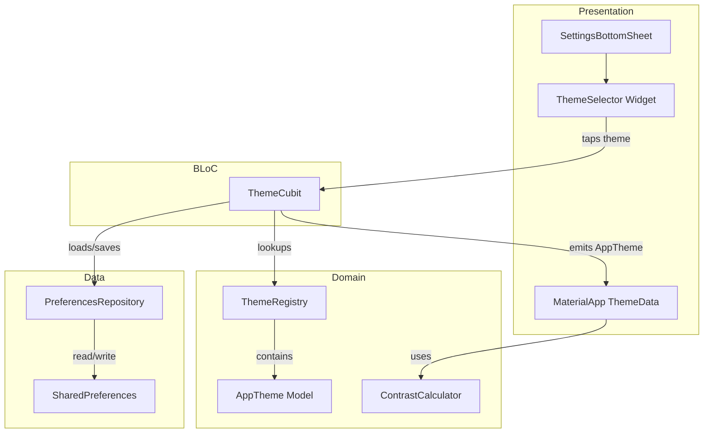

# Design Document: Theme Selection

## Overview

The Theme Selection feature adds user-customizable color themes to the Jigsaw Puzzle Game. Users choose from five predefined themes (Light, Dark, Ocean, Sunset, Forest) via the existing settings bottom sheet. The selected theme applies globally to all screens through Flutter's `MaterialApp`-level `ThemeData`, and persists across app restarts using the existing `SharedPreferences` infrastructure.

The design follows the established BLoC/Cubit pattern already used for audio settings. A new `ThemeCubit` mirrors the `AudioSettingsCubit` lifecycle: it loads the persisted theme on startup, emits theme changes, and persists selections. The `PreferencesRepository` is extended with `loadThemeId`/`saveThemeId` methods. A `ThemeSelector` widget is added to the `SettingsBottomSheet` below the Sound Effects toggle.

Button and text contrast is handled automatically by Flutter's `ColorScheme.fromSeed` mechanism, with a dedicated `ContrastCalculator` utility to verify and enforce WCAG AA 4.5:1 contrast ratios across all five themes.

## Architecture

The feature integrates into the existing layered architecture:



**Data flow:**

1. On app startup, `ThemeCubit.init()` loads the persisted theme ID from `PreferencesRepository`, resolves it via `ThemeRegistry`, and emits the `AppTheme`.
2. `MaterialApp` rebuilds its `ThemeData` from the emitted `AppTheme` via a `BlocBuilder<ThemeCubit, ThemeState>`.
3. When the user taps a theme in `ThemeSelector`, `ThemeCubit.selectTheme(id)` persists the ID and emits the new `AppTheme`.
4. All screens automatically inherit the updated theme through `Theme.of(context)`.

## Components and Interfaces

### 1. AppTheme (Domain Model)

```dart
/// lib/domain/app_theme.dart
class AppTheme extends Equatable {
  final String id;           // e.g., "light", "dark", "ocean"
  final String displayName;  // e.g., "Light", "Dark", "Ocean"
  final Color seedColor;     // Seed color for ColorScheme.fromSeed
  final Brightness brightness; // Brightness.light or Brightness.dark

  const AppTheme({
    required this.id,
    required this.displayName,
    required this.seedColor,
    required this.brightness,
  });

  @override
  List<Object?> get props => [id, displayName, seedColor, brightness];
}
```

### 2. ThemeRegistry (Domain)

```dart
/// lib/domain/theme_registry.dart
class ThemeRegistry {
  static const List<AppTheme> themes = [ /* 5 themes */ ];
  static const AppTheme defaultTheme = /* Light theme */;

  /// Returns the AppTheme matching [id], or [defaultTheme] if not found.
  static AppTheme findById(String id);
}
```

The registry is a static, immutable collection. The five themes in order:

| ID       | Display Name | Seed Color         | Brightness |
|----------|--------------|--------------------|------------|
| `light`  | Light        | `Colors.deepPurple`| light      |
| `dark`   | Dark         | `Colors.deepPurple`| dark       |
| `ocean`  | Ocean        | `Colors.blue`      | dark       |
| `sunset` | Sunset       | `Colors.deepOrange`| light      |
| `forest` | Forest       | `Colors.green`     | dark       |

**Design decision:** Using `ColorScheme.fromSeed` with a seed color and brightness lets Flutter's Material 3 algorithm generate a full, harmonious color scheme automatically. This avoids manually specifying dozens of color values and ensures consistent contrast across surfaces, text, and buttons. The `Brightness` parameter controls whether the scheme is light or dark, which directly affects foreground/background contrast.

### 3. ContrastCalculator (Domain Utility)

```dart
/// lib/domain/contrast_calculator.dart
class ContrastCalculator {
  /// Computes the WCAG relative luminance contrast ratio between two colors.
  /// Returns a value >= 1.0 (e.g., 4.5 means 4.5:1).
  static double contrastRatio(Color a, Color b);

  /// Returns true if the contrast ratio between [foreground] and [background]
  /// meets WCAG AA (>= 4.5:1 for normal text).
  static bool meetsWcagAA(Color foreground, Color background);
}
```

The contrast ratio formula follows WCAG 2.1: `(L1 + 0.05) / (L2 + 0.05)` where L1 is the lighter relative luminance. This is a pure function with no dependencies.

### 4. PreferencesRepository (Extended)

Add two methods to the abstract class and implementation:

```dart
// Abstract additions:
Future<String?> loadThemeId();
Future<void> saveThemeId(String themeId);

// Implementation key:
static const _keyThemeId = 'theme_id';
```

### 5. ThemeCubit (BLoC Layer)

```dart
/// lib/bloc/theme/theme_cubit.dart
class ThemeState extends Equatable {
  final bool isLoaded;
  final AppTheme theme;
  // ...
}

class ThemeCubit extends Cubit<ThemeState> {
  ThemeCubit({required PreferencesRepository preferencesRepository});

  Future<void> init();              // Load persisted theme
  Future<void> selectTheme(String themeId); // Select and persist
}
```

Follows the same pattern as `AudioSettingsCubit`: constructor takes `PreferencesRepository`, `init()` loads from persistence, mutation methods persist then emit.

### 6. ThemeSelector Widget (Presentation)

A horizontal row of tappable theme swatches displayed in the `SettingsBottomSheet` below the Sound Effects toggle. Each swatch shows:
- A circular color preview filled with the theme's seed color
- The theme display name below
- A check mark overlay on the currently active theme

### 7. Updated Wiring

- **`settings_action.dart`**: Pass `ThemeCubit` via `BlocProvider.value` alongside `AudioSettingsCubit` when opening the bottom sheet. Use `MultiBlocProvider` to provide both.
- **`settings_bottom_sheet.dart`**: Add `ThemeSelector` widget below the Sound Effects `SwitchListTile`.
- **`main.dart`**: 
  - Create `ThemeCubit` in `_JigsawPuzzleAppState.initState()`, call `init()`.
  - Add `BlocProvider<ThemeCubit>.value` to `MultiBlocProvider`.
  - Wrap `MaterialApp` in `BlocBuilder<ThemeCubit, ThemeState>` to rebuild `ThemeData` when the theme changes.
  - Replace the hardcoded `ThemeData(colorScheme: ColorScheme.fromSeed(seedColor: Colors.deepPurple))` with a dynamic `ThemeData` built from the active `AppTheme`.

## Data Models

### AppTheme

| Field         | Type         | Description                                      |
|---------------|--------------|--------------------------------------------------|
| `id`          | `String`     | Unique identifier (e.g., `"light"`, `"ocean"`)   |
| `displayName` | `String`     | Human-readable name (e.g., `"Light"`, `"Ocean"`) |
| `seedColor`   | `Color`      | Seed color for `ColorScheme.fromSeed`             |
| `brightness`  | `Brightness` | `Brightness.light` or `Brightness.dark`           |

Extends `Equatable` with props `[id, displayName, seedColor, brightness]`.

### ThemeState

| Field     | Type       | Description                                    |
|-----------|------------|------------------------------------------------|
| `isLoaded`| `bool`     | Whether the theme has been loaded from storage |
| `theme`   | `AppTheme` | The currently active theme                     |

Extends `Equatable` with props `[isLoaded, theme]`.

### Persistence Format

A single `String` value stored under the key `"theme_id"` in `SharedPreferences`. Valid values: `"light"`, `"dark"`, `"ocean"`, `"sunset"`, `"forest"`. Any unrecognized value falls back to `"light"`.

## Correctness Properties

*A property is a characteristic or behavior that should hold true across all valid executions of a system — essentially, a formal statement about what the system should do. Properties serve as the bridge between human-readable specifications and machine-verifiable correctness guarantees.*

### Property 1: Contrast ratio is symmetric and bounded

*For any* two colors A and B, `contrastRatio(A, B)` SHALL equal `contrastRatio(B, A)`, and the result SHALL be in the range [1.0, 21.0].

**Validates: Requirements 4.1, 4.2, 4.3**

### Property 2: All themes meet WCAG AA contrast

*For any* `AppTheme` in the `ThemeRegistry`, the `ColorScheme` generated from that theme SHALL produce a foreground-to-background contrast ratio of at least 4.5:1 for primary container content, surface content, and button text.

**Validates: Requirements 4.4**

### Property 3: Theme persistence round-trip

*For any* valid theme ID string from the `ThemeRegistry`, saving it via `PreferencesRepository.saveThemeId` and then loading it via `PreferencesRepository.loadThemeId` SHALL return the same theme ID string.

**Validates: Requirements 5.1**

### Property 4: Invalid theme ID fallback

*For any* string that is NOT a valid theme ID in the `ThemeRegistry`, calling `ThemeRegistry.findById` with that string SHALL return the default "Light" theme.

**Validates: Requirements 5.3**

### Property 5: Theme registry serialization round-trip

*For any* `AppTheme` in the `ThemeRegistry`, `ThemeRegistry.findById(theme.id)` SHALL return an `AppTheme` that is equal to the original theme.

**Validates: Requirements 6.2, 6.3**

## Error Handling

| Scenario | Handling |
|---|---|
| Persisted theme ID is `null` (first launch) | `ThemeCubit.init()` defaults to `ThemeRegistry.defaultTheme` (Light) |
| Persisted theme ID is an unrecognized string | `ThemeRegistry.findById` returns `defaultTheme`; `ThemeCubit` persists the corrected ID (`"light"`) |
| `SharedPreferences` read fails | Catch exception in `ThemeCubit.init()`, fall back to Light theme, log error |
| `SharedPreferences` write fails | Catch exception in `ThemeCubit.selectTheme()`, still emit the new theme (UI updates even if persistence fails), log error |
| `ThemeRegistry.themes` is empty (should never happen — compile-time constant) | `defaultTheme` is a `const` — no runtime failure possible |

## Testing Strategy

### Unit Tests (Example-Based)

- **ThemeRegistry**: Verify 5 themes in correct order, unique IDs, correct seed colors and brightness values (Req 1.1–1.7)
- **AppTheme model**: Equatable behavior, props correctness
- **ThemeCubit**: 
  - `init()` loads and emits persisted theme (Req 5.2)
  - `init()` with no saved preference defaults to Light (Req 5.4)
  - `selectTheme()` emits new theme and persists (Req 2.4)
  - `init()` with invalid ID falls back and persists corrected ID (Req 5.3)
- **PreferencesRepository**: `loadThemeId`/`saveThemeId` with concrete values
- **ContrastCalculator**: Known color pairs with expected ratios (e.g., black/white = 21:1)

### Widget Tests (Example-Based)

- **ThemeSelector**: Renders 5 swatches with names, shows check on active theme (Req 2.1–2.3, 2.5)
- **SettingsBottomSheet**: Theme selector appears below Sound Effects toggle (Req 2.5)
- **Theme application**: Verify `MaterialApp` rebuilds `ThemeData` when `ThemeCubit` emits (Req 3.4)

### Property-Based Tests (glados)

The project uses the `glados` package for property-based testing. Each property test runs a minimum of 100 iterations.

- **Property 1** — Contrast ratio symmetry and bounds: Generate random color pairs, verify `contrastRatio(a, b) == contrastRatio(b, a)` and result ∈ [1.0, 21.0].
  - Tag: `Feature: theme-selection, Property 1: Contrast ratio is symmetric and bounded`
- **Property 2** — WCAG AA compliance: For each theme in the registry, generate the `ColorScheme` and verify key contrast pairs meet 4.5:1.
  - Tag: `Feature: theme-selection, Property 2: All themes meet WCAG AA contrast`
- **Property 3** — Persistence round-trip: For any theme ID from the registry, save then load returns the same ID.
  - Tag: `Feature: theme-selection, Property 3: Theme persistence round-trip`
- **Property 4** — Invalid ID fallback: Generate random strings (excluding valid IDs), verify `findById` returns the default theme.
  - Tag: `Feature: theme-selection, Property 4: Invalid theme ID fallback`
- **Property 5** — Registry round-trip: For any theme in the registry, `findById(theme.id)` equals the original theme.
  - Tag: `Feature: theme-selection, Property 5: Theme registry serialization round-trip`

### Integration Tests

- End-to-end flow: Open settings → select theme → verify all screens update colors (Req 3.1–3.3)
- Persistence flow: Select theme → restart app → verify theme is restored (Req 5.1–5.2)

